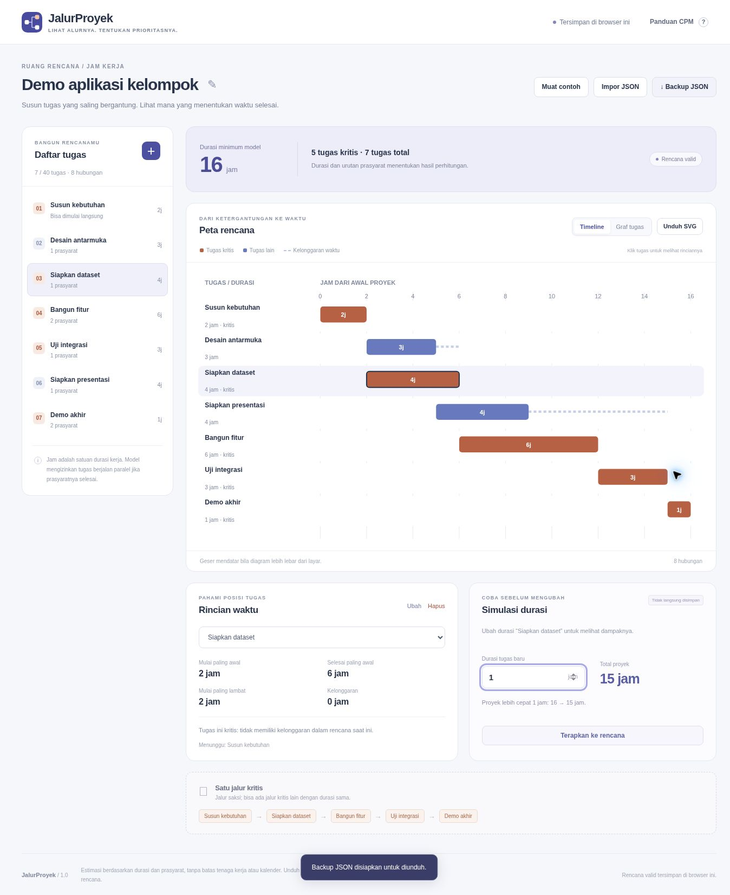
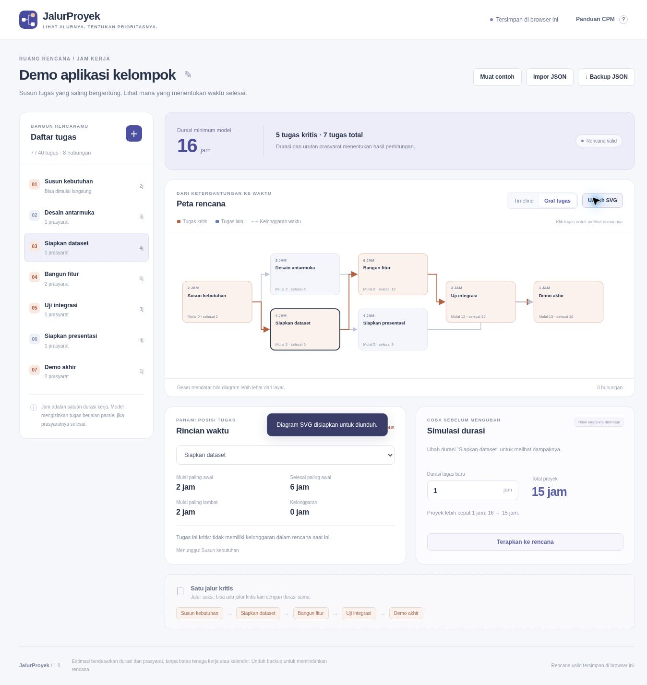

# JalurProyek

**[Coba langsung di browser](https://mavianza-lab.amav1305.chatgpt.site/coba/jalurproyek/)** · [Galeri Mavianza Lab](https://mavianza-lab.amav1305.chatgpt.site/)

Versi online dapat dipakai tanpa instalasi atau akun. Data tersimpan di browser dan domain yang dipakai; gunakan backup JSON untuk memindahkan data dari versi lokal.


**Perencana visual ketergantungan tugas dan jalur kritis, untuk proyek kuliah dan pekerjaan kelompok.** Susun tugas melalui form, lihat kapan setiap tugas bisa dimulai, lalu coba perubahan durasi sebelum menyimpannya. Tidak perlu akun, API key, koneksi internet saat dipakai, atau instalasi paket JavaScript.



## Masalah yang dibantu

Daftar tugas saja belum menunjukkan pekerjaan mana yang menentukan waktu selesai. Mempercepat satu tugas juga belum tentu mempercepat seluruh proyek sebesar waktu yang dipotong. JalurProyek menghubungkan prasyarat, waktu mulai, kelonggaran, dan simulasi dalam satu tampilan. Contoh proyek merupakan **data sintetis untuk belajar**, bukan hasil observasi atau pengujian lapangan.

## Lima fitur yang terhubung

1. **Rencana melalui form:** tambah, ubah, dan hapus tugas; tentukan durasi jam kerja serta prasyarat dari daftar centang. Nama proyek dapat diubah. Tugas yang masih menjadi prasyarat tidak bisa dihapus sebelum hubungannya dilepas.
2. **Perhitungan CPM:** waktu mulai/selesai paling awal, mulai/selesai paling lambat, kelonggaran, dan durasi minimum model. Semua tugas dan hubungan kritis ditandai; satu jalur kritis ditampilkan sebagai contoh lintasan lengkap.
3. **Dua visualisasi:** timeline durasi dan graf ketergantungan. Klik tugas untuk melihat rincian waktu. Diagram dapat diunduh sebagai SVG mandiri, termasuk label dan warna.
4. **Simulasi durasi:** coba durasi baru untuk tugas terpilih, lihat perubahan total proyek, lalu simpan melalui tombol **Terapkan ke rencana** jika sesuai.
5. **Penyimpanan dan pemindahan rencana:** perubahan valid otomatis tersimpan di browser; unduh backup JSON dan impor kembali dengan menempelkan isinya. Kesalahan data ditampilkan sebelum rencana aktif diganti.

## Instalasi dan menjalankan

Kebutuhan: **Python 3.10+** dan browser modern yang mendukung JavaScript modules, `structuredClone`, serta `crypto.randomUUID` (misalnya Chrome atau Edge). Semua source dan aset sudah disertakan. Node.js hanya dibutuhkan untuk menjalankan tes JavaScript.

1. Unduh ZIP repository, lalu ekstrak seluruh folder.
2. Di Windows, klik dua kali **`Mulai_App.cmd`**. Jendela server harus tetap terbuka saat aplikasi digunakan.
3. Di macOS/Linux, atau jika menggunakan terminal:

   ```sh
   python3 server.py
   ```

   Di Windows alternatifnya: `py -3 server.py` atau `python server.py`.

4. Browser akan membuka **http://127.0.0.1:8753/**. Jika tidak terbuka otomatis, buka alamat itu sendiri. Hentikan server dengan Ctrl+C.

Tidak ada `pip install`, `npm install`, database server, atau proses build untuk pemakaian biasa. Peluncur hanya menyajikan aset aplikasi di loopback; isi rencana dikelola di browser dan tidak dikirim ke server.

Jika port sedang dipakai:

```sh
python3 server.py --port 8754
```

Gunakan `--no-browser` untuk menjalankan server tanpa membuka tab otomatis. **Data browser mengikuti origin**: hostname dan port yang berbeda memiliki penyimpanan berbeda. Gunakan port yang sama setiap hari, atau pindahkan rencana dengan backup JSON. Membuka `web/index.html` langsung lewat `file://` bukan cara yang didukung karena pembatasan modules pada browser.

## Coba alur lengkap dalam dua menit

1. Pilih **Muat contoh**, lalu konfirmasi. Contoh berisi tujuh tugas dan delapan hubungan.
2. Ringkasan menampilkan **16 jam**, dengan jalur kritis: Susun kebutuhan → Siapkan dataset → Bangun fitur → Uji integrasi → Demo akhir.
3. Pada **Rincian waktu**, pilih **Siapkan dataset**. Durasi awalnya 4 jam, mulai jam 2 dan selesai jam 6.
4. Pada **Simulasi durasi**, isi **1**. Total simulasi menjadi **15 jam**, sedangkan ringkasan rencana masih 16 jam. Pemotongan 3 jam hanya menghemat 1 jam proyek karena jalur melalui Desain antarmuka menjadi pembatas baru.
5. Klik **Terapkan ke rencana**. Ringkasan menjadi 15 jam; muat ulang halaman untuk melihat rencana tetap tersimpan.
6. Unduh **Backup JSON**. Untuk mengembalikannya, buka berkas di editor teks, salin seluruh isi, pilih **Impor JSON**, tempel, lalu **Periksa dan impor**. Impor valid mengganti rencana aktif; simpan backup lama bila masih diperlukan.

Berkas [examples/demo.json](examples/demo.json) dapat dipakai untuk impor. Hasil contoh juga tersedia sebagai [timeline.svg](examples/timeline.svg) dan [graf.svg](examples/graf.svg).



## Pendalaman teknis dan jaminan perilaku

**Jaminan 1 — hasil deterministik.** Dokumen valid dengan ID, nama, durasi, dan hubungan yang sama menghasilkan hasil CPM yang sama meskipun urutan array tugas atau prasyarat diubah. ID ASCII dibandingkan secara case-sensitive, antrean topologis diurutkan, dan pemilihan jalur saksi memakai aturan yang sama. Waktu mulai proyek ditetapkan pada 0.

**Jaminan 2 — kandidat gagal tidak mengganti rencana aktif.** Validasi struktur, pemeriksaan siklus, perhitungan, dan serialisasi selesai sebelum satu nilai localStorage ditulis. Sesi aktif baru diperbarui setelah penulisan berhasil. Siklus, backup rusak, rujukan hilang, serta kegagalan penulisan yang menolak operasi meninggalkan dokumen dan hasil perhitungan sebelumnya tetap utuh. Data tersimpan yang rusak tidak dihapus otomatis; tersedia unduhan mentah dan reset eksplisit.

Tes integrasi mencakup alur buat → hubungkan → hitung → ubah → reload → ekspor → impor, serta siklus dan kegagalan simpan. Perhitungan pada **200 DAG kecil** dibandingkan dengan oracle independen yang mengenumerasi seluruh jalur root-ke-sink, termasuk kelonggaran tiap tugas. Detail hasil aktual di [docs/PENGUJIAN.md](docs/PENGUJIAN.md).

### Keputusan implementasi

- `model.mjs` memvalidasi schema ketat, ID unik, durasi, nama Unicode, dan rujukan; hasil dinormalisasi tanpa memutasi input.
- `planner.mjs` memakai urutan topologis Kahn, lintasan maju dan mundur CPM. DFS memberikan lintasan siklus yang dapat diperbaiki pengguna. Tidak ada enumerasi semua jalur pada aplikasi; hanya tes oracle yang melakukannya pada graf kecil.
- `storage.mjs` memisahkan data aktif dari kandidat. Satu kunci memuat satu dokumen lengkap. Pemeriksaan nilai dasar mendeteksi tab yang sudah tertinggal; ini **bukan transaksi compare-and-swap lintas tab**. Gunakan satu tab aktif ketika mengubah rencana.
- `diagrams.mjs` membuat SVG tanpa pustaka eksternal, meng-escape teks XML dan membungkus label menurut code point agar pasangan Unicode tidak terpotong.
- `app.mjs` menangani form, pilihan tugas, dialog, dan umpan balik. Hasil simulasi berada di memori sampai diterapkan.
- `server.py` hanya menyajikan daftar aset tetap. Header CSP memblokir koneksi jaringan dari aplikasi. Tidak ada endpoint untuk menerima data proyek.

### Batas yang perlu dipahami

- CPM ini mengizinkan kerja **paralel tanpa batas tenaga kerja/peralatan**. Hasil merupakan durasi minimum untuk model prasyarat; bukan janji tanggal selesai, pembagian orang, estimasi probabilistik, kalender, atau penjadwalan berbatas sumber daya.
- Maksimal **40 tugas**, **150 hubungan**, durasi bilangan bulat **1–720 jam per tugas**, nama maksimal 80 unit teks UTF-16, ID ASCII maksimal 64 karakter. Backup maksimal **256.000 byte UTF-8**; versi schema yang didukung hanya 1.
- Hubungan finish-to-start tanpa jeda. Tidak mendukung durasi nol, tugas berulang, tenggat, atau keterlambatan per hubungan.
- Beberapa jalur bisa sama-sama kritis. Semua tugas/hubungan kritis ditandai; hanya **satu jalur saksi deterministik** dituliskan untuk menghindari ledakan jumlah lintasan.
- Rencana tersimpan pada browser/perangkat/origin yang sama. Mode privat, pembersihan data browser, atau kerusakan perangkat dapat menghilangkan data; unduh backup secara berkala. Aplikasi tidak menyinkronkan data lintas perangkat atau memberi jaminan pemulihan saat perangkat kehilangan daya.
- Pada graf padat, garis dapat berpotongan. Diagram dapat digeser mendatar; nama panjang dapat dibungkus/dipotong secara visual, dengan nama lengkap tetap ada pada pilihan tugas dan tooltip SVG.

## Pengujian

Dengan Node.js 20+ dan Python 3.10+:

```sh
node --test tests/*.test.mjs
npm run check
python3 -m unittest discover -s tests -p "test_*.py" -v
```

`npm run check` tidak memasang paket. Pada Windows gunakan `python` atau `py -3` sesuai instalasi. Tes HTTP memakai port loopback sementara dan menutupnya setelah selesai. Tes penyimpanan memakai penyimpanan memori yang dapat dibuat gagal; uji browser aktual dicatat terpisah.

## Struktur berkas

| Lokasi | Peran |
| --- | --- |
| `web/` | Antarmuka, model, algoritma, persistensi, render SVG, contoh |
| `server.py`, `Mulai_App.cmd` | Peluncur aplikasi lokal |
| `tests/` | Tes Node.js dan integrasi HTTP Python |
| `examples/` | Backup dan diagram contoh siap dibuka |
| `docs/` | Screenshot aktual serta hasil pengujian |
| `package.json` | Perintah pemeriksaan; tanpa dependensi eksternal |

Lisensi MIT. Dibuat untuk proyek harian 15 November 2026.
